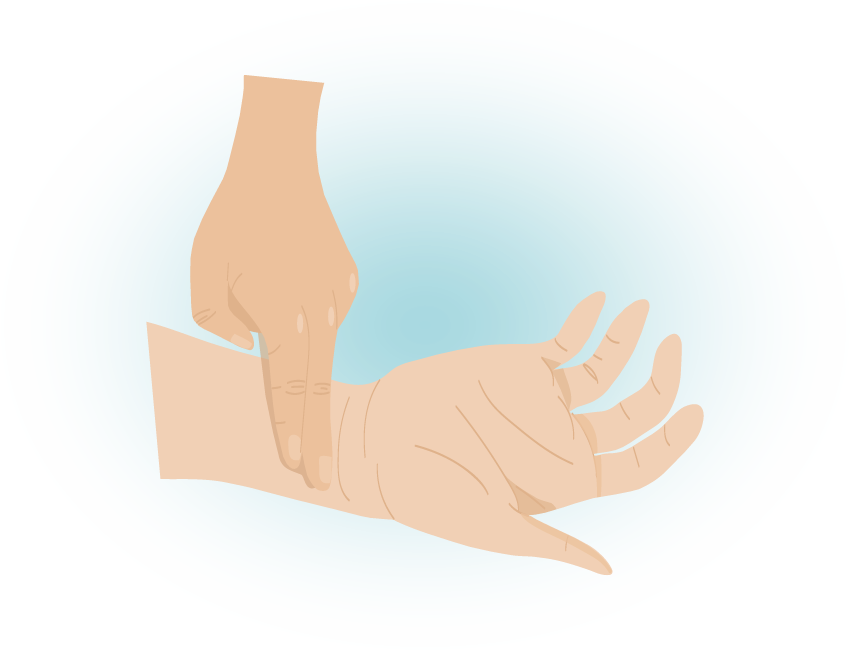
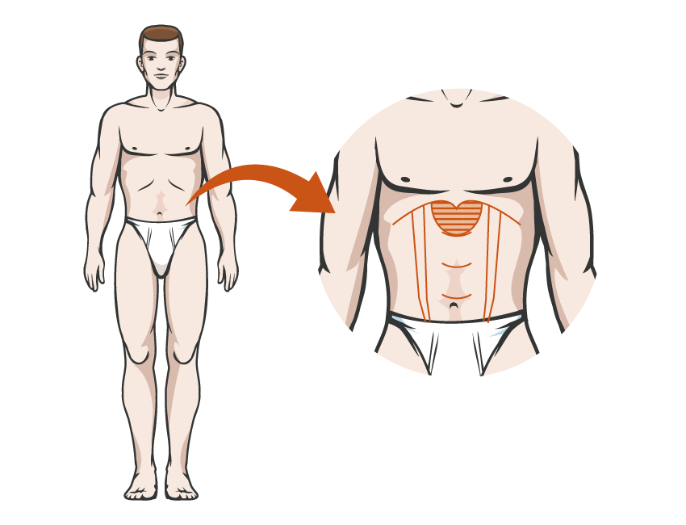

우리 몸은 기혈(기운과 혈액)이 원활하게 순환될 수 있어야 합니다.
만약 어깨쪽으로 혈액순환이 나빠서 결린다거나 또는 한쪽 팔만 아픈 것처럼 부분적으로 기혈의 순환이 나빠진 경우에는 침과 뜸을 이용해서 그 부위의 순환을 활발하게 해줍니다.
하지만 몸에 전체적으로 나타난 증상이라든지, 근육과 같이 외부의 이상이 아니라 내부 장기의 기능에 관계되는 증상은 기혈의 순환보다는 기혈이 부족해져서 증상이 나타난 것이어서 침과 뜸만으로 접근하기에는 한계가 있을 수 있습니다.
그렇기 때문에 침치료만으로는 증상이 반복되거나 오래된 증상이라 변화가 더딘 경우에는 침과 약을 함께 쓰는 방법을 고려합니다.

### 만성피로, 허약
• 자고 일어나도 피로가 풀리지 않는다
• 아침에 일어나기가 너무 힘들다
• 몸이 너무 무겁다는 느낌을 자주 느낀다
• 가벼운 몸살기같은 근육통을 자주 느낀다
• 감기가 오랫동안 잘 낫지 않는다
• 눈이 쉽게 침침해진다

### 여드름, 피부질환
• 성인이 되었는데도 여드름이 없어지지 않는다
• 생리때면 여드름이 더 심해진다
• 피부건조감, 각질, 가려움증이 자주 생긴다
• 습진, 아토피, 묘기증 등이 있다

### 수족냉증
• 추위를 너무 많이 탄다
• 겨울이 되면 손발이 너무 시리다
• 여름에도 수면양말을 신어야 할 정도로 발이 차갑다
• 추위를 타는데도 손·발바닥이나 얼굴은 너무 뜨겁다
• 손끝이 색깔이 변할 정도로 차가워진다(레이노 증후군)

### 생리(월경) 이상
• 생리통이 심해서 진통제를 먹어야 한다
• 생리가 일찍 끊기거나 양이 많이 줄어들었다
• 생리를 너무 오래 하거나 한달에 두번하는 일이 있다
• 생리불순이 있거나 생리 색깔이 어둡고 덩어리가 섞여 있다

### 임신과 출산
• 임신이 잘 되지 않는다
• 임신이 되었으나 쉽게 유산이 된다
• 임신중 태동(복통)이나 태루(하혈)이 있다
• 입덧이 너무 심하다
• 태아가 잘 자라지 않는다
• 순조롭게 자연분만을 하고 싶다
• 산후에 붓기를 빼고, 산후조리를 잘 하고 싶다

### 어린이 한약
• 음식을 잘 먹지 않는다
• 땀을 너무 많이 흘리고 허약하다
• 키가 잘 자라지 않는다
• 비염, 아토피 등 알러지 성향이 있다

### 기타 증상
• 심한 소화불량, 체기
• 감기, 몸살
• 만성 두통, 이명, 어지럼증
• 요통, 관절통증

### 진단을 중심에 둡니다

한약은 어떤 약재를 쓰느냐만큼, 지금 이 몸의 상태를 어떻게 파악하느냐가 중요하다고 생각합니다.

많은 분들이 한약재의 원산지나 약의 진하기로 한약의 질을 평가하십니다. 물론 중요한 요소지만, 저희는 처방의 방향을 정하는 진단 과정에 더 무게를 둡니다.

한의학은 진단기계로 원인을 찾는 의학이 아니라서 진단이 한의사의 숙련도와 경험에 많이 의존합니다. 그래서 저희는 진맥과 복진을 함께 보며 충분히 이야기를 나눈 뒤 처방의 방향을 정합니다.

### 진맥

옛말에 "맥을 귀신처럼 본다(診脈如神)"는 말이 있습니다. 그래서인지 한의학의 진단이라고 하면 누구나 진맥을 떠올립니다. 실제로 한의학에서 진맥은 다른 진단에 비해 가장 중심이 되는 진단방법으로 다른 모든 진단보다도 진맥이 가장 중요합니다.

하지만 진맥은 배우기 쉽지 않습니다. 진맥의 특성상 선생이 제자에게 일대일로 전수해야 하고, 익숙해지기까지 수련하는 시간도 오래 걸립니다.

저희 한의원에서는 진맥을 중심으로 몸의 상태를 살피고 처방합니다. 그만큼 맥이 진단에 중요하다고 생각하기 때문입니다. 맥을 차분히 관찰하고 그 결과를 해석하는 데 시간을 들이며, 그 해석에 따라 처방의 방향이 달라집니다.

### 복진

저희 한의원에서 사용하는 또 다른 진단법으로 복진이 있습니다. 복진은 말 그대로 배를 눌러봐서 증상을 판단하는 방법입니다. 주로 명치에서 배꼽아래에 해당하는 복부를 8개 영역으로 나눠서 각 부분부분에 이상이 있는지를 확인합니다.

복진은 일본에서 만들어진 진단방법으로 수백년간 발전을 거듭해왔습니다. 그래서 우리나라에는 생소한 진단법이기는 하지만, 진맥과 함께 보면 그 당시의 몸 상태를 서로 맞춰볼 수 있다고 생각해서 함께 사용합니다.

### 충분히 이야기를 나누고 처방합니다

*충분히 이야기를 나눈 뒤 처방합니다*

한의학의 전통적인 진단법은 한의학의 이론과 맞닿아 있어서 한약 처방의 근거가 되는 중요한 방법입니다.

저희 한의원에서는 환자분의 건강 상태와 생활 습관을 꼼꼼히 살펴 몸 상태에 맞는 한약을 처방합니다. 한약 복용 시 주의사항과 복용 방법을 충분히 안내해드리며, 궁금한 점이 있으시면 언제든 상담해 주세요.
